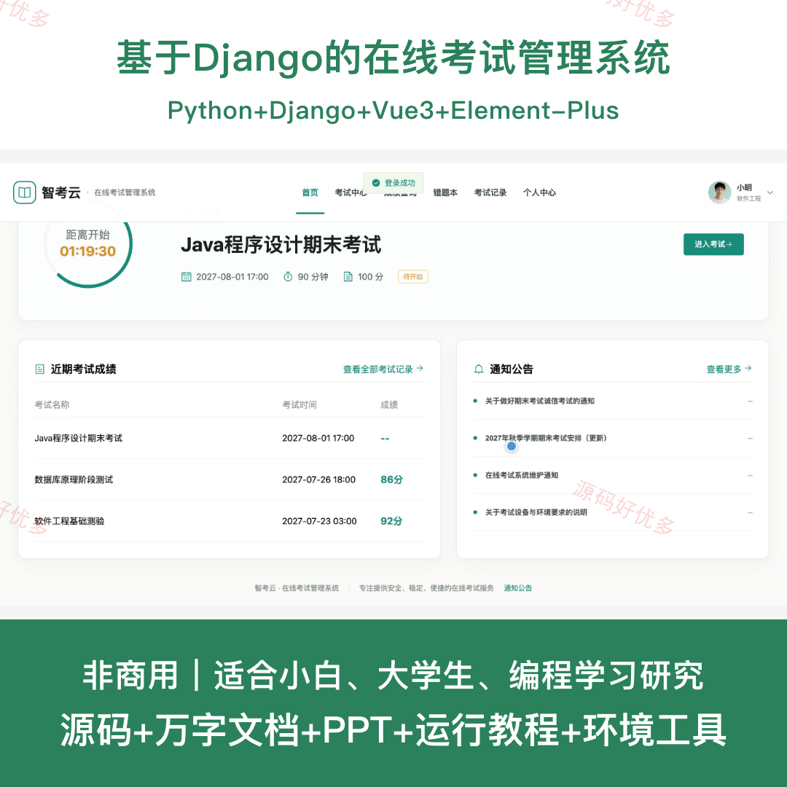
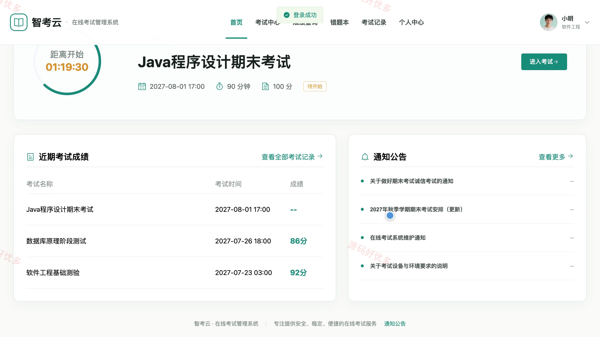
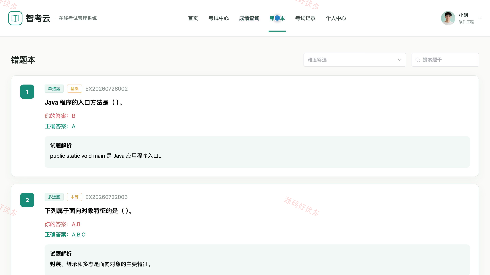
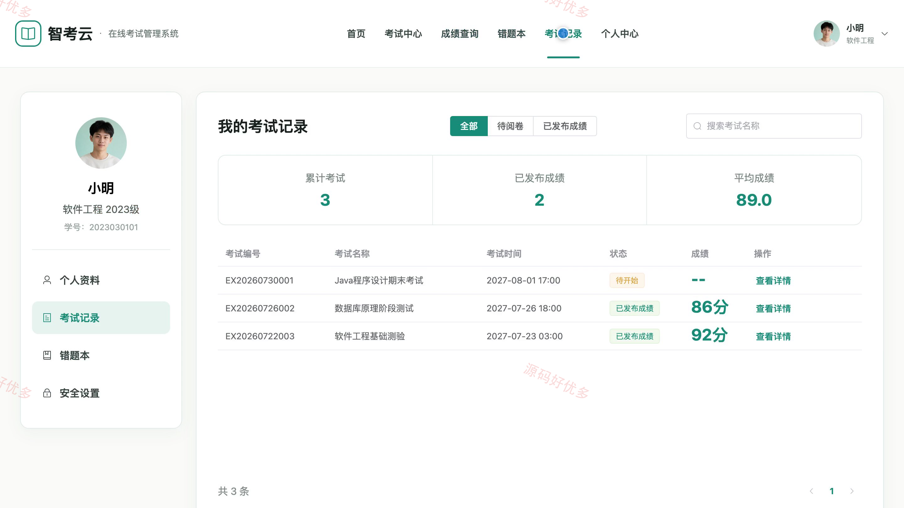
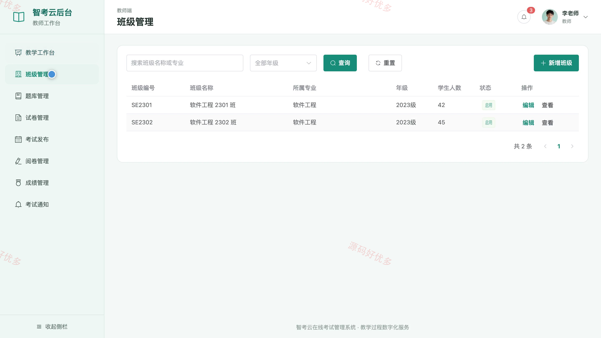
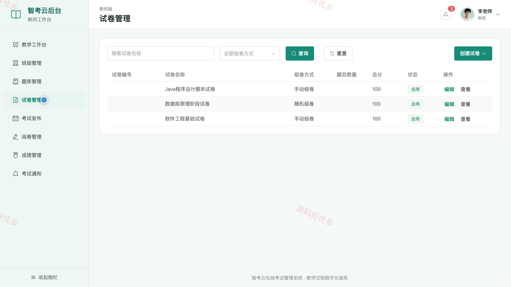
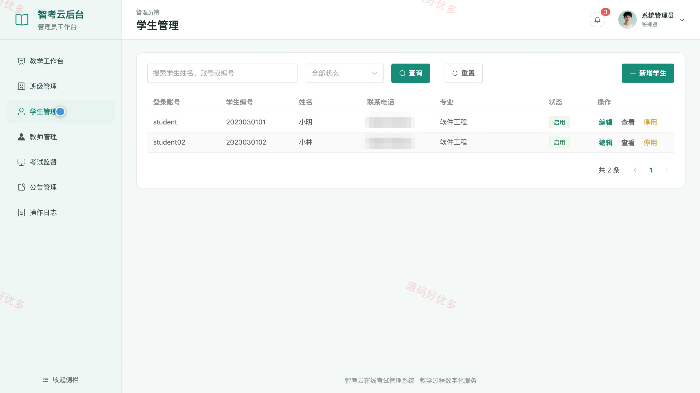
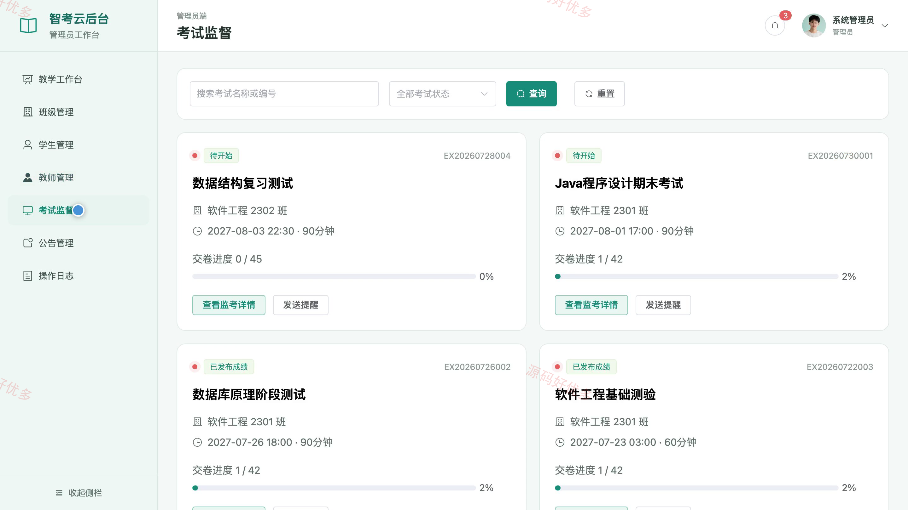

# bs008C
bs008C基于Django的在线考试管理系统源码 Python Django Vue3 文档 PPT
## 源码问题查看主页咨询

### 一、关键词
在线考试管理系统、在线测评、题库管理、智能组卷、成绩分析

### 二、作品包含
源码+数据库+万字设计文档+PPT+全套环境和工具资源+本地部署教程

### 三、项目技术
前端技术： Html、Css、Js、Vue3.4、Element-Plus
后端技术：Python、Django

### 四、运行环境要求
开发工具：PyCharm + VSCODE

数据库：MySQL5.7+（共12张表）

数据库管理工具：Navicat10以上版本

环境配置软件： Python3+

前端Nodejs：16+

浏览器：谷歌浏览器

### 五、项目介绍
项目编号：bs008C

本系统面向在线教学考试与测评场景，为学生提供考试参与、在线答题、成绩查询和错题复习，为教师提供班级、题库、组卷、考试发布、阅卷与成绩管理，为管理员提供账号、考试监督、公告和操作日志管理。

角色：学生、教师、管理员

学生功能：考试中心、在线答题、答卷保存与交卷、考试记录、成绩查询、错题复习、通知公告、个人资料维护。

教师功能：教学工作台、班级管理、题库管理、手动与随机组卷、考试发布、阅卷管理、成绩发布、考试通知。

管理员功能：管理工作台、班级管理、学生管理、教师管理、考试监督、公告管理、操作日志、个人资料维护。

### 六、运行截图

